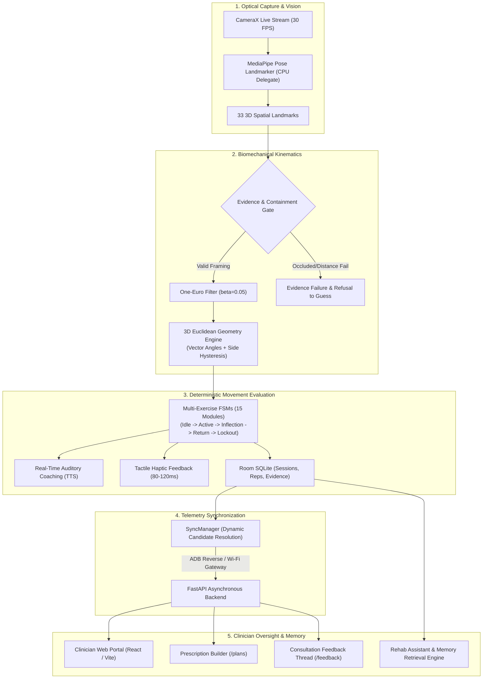
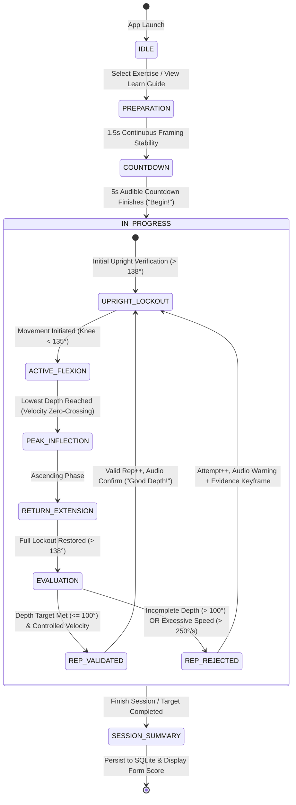
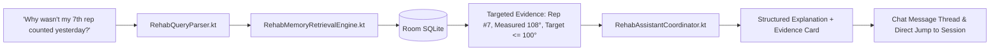
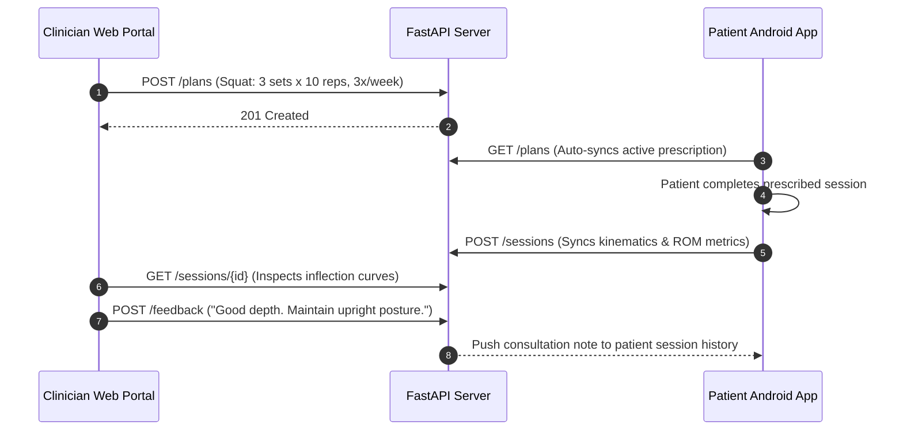

# KinexMed — Clinical Movement Intelligence and Multi-Exercise Rehabilitation Platform

[](https://github.com/KatkamKoushik/KinexMed/releases/tag/v1.0.0)
[-success.svg)](https://github.com/KatkamKoushik/KinexMed/releases/download/v1.0.0/app-debug.apk)
[](https://fastapi.tiangolo.com)
[](https://developer.android.com)
[](https://developers.google.com/mediapipe)
[](https://react.dev)
[](https://opensource.org/licenses/MIT)

> Edge-native physical rehabilitation platform enabling real-time biomechanical analysis, local-first conversational rehabilitation memory, and automated clinician review.

**KinexMed** is an edge-native, real-time physical rehabilitation observation platform. It enables patients to perform prescribed physical therapy exercises under automated on-device computer vision observation using a standard Android smartphone, while streaming validated kinematic metrics to a clinician portal.

KinexMed operates on a strict **zero-mock-data integrity** principle: all telemetry, range-of-motion (ROM) measurements, repetition timestamps, and evidence logs originate solely from live on-device anatomical landmark geometry.

---

## Technical Documentation Wiki

Comprehensive architecture, mathematical formulas, ergonomic design specifications, and physical runbooks are documented in the [KinexMed Wiki](file:///D:/KinexMed/wiki/Home.md):

- [Wiki Home & Platform Vision](file:///D:/KinexMed/wiki/Home.md)
- [System Architecture & 10-Stage Processing Pipeline](file:///D:/KinexMed/wiki/System-Architecture-and-Pipeline.md)
- [Biomechanical Geometry & Exercise FSMs](file:///D:/KinexMed/wiki/Biomechanical-Geometry-and-FSM.md)
- [Mobile UX Architecture & Native Ergonomics](file:///D:/KinexMed/wiki/Mobile-Ergonomics-and-Touch-Architecture.md)
- [Local Rehab Memory & Conversational Assistant](file:///D:/KinexMed/wiki/Local-Rehab-Memory-and-Assistant.md)
- [Clinician Portal & REST API Backend](file:///D:/KinexMed/wiki/Clinician-Portal-and-Backend-API.md)
- [Physical Validation & Troubleshooting Guide](file:///D:/KinexMed/wiki/Physical-Validation-and-Troubleshooting.md)

---

## Latest Release & Android APK Download

The latest pre-compiled Android APK (**v1.0.0**) is available directly via GitHub Releases:

- **Direct APK Download:** [Download KinexMed v1.0.0 APK (`app-debug.apk`)](https://github.com/KatkamKoushik/KinexMed/releases/download/v1.0.0/app-debug.apk)
- **GitHub Release Page:** [KinexMed v1.0.0 Release Notes](https://github.com/KatkamKoushik/KinexMed/releases/tag/v1.0.0)
- **Local Build Output:** `android/app/build/outputs/apk/debug/app-debug.apk`

### Installing on Android Device via ADB

```bash
adb install -r android/app/build/outputs/apk/debug/app-debug.apk
```

---

## Project Authors & Contributors

### Koushik Katkam
- Email: [koushikkatkam@gmail.com](mailto:koushikkatkam@gmail.com)
- GitHub: [https://github.com/KatkamKoushik](https://github.com/KatkamKoushik)
- LinkedIn: [https://linkedin.com/in/koushik-katkam](https://linkedin.com/in/koushik-katkam)
- Instagram: [https://instagram.com/koushik_katkam](https://instagram.com/koushik_katkam)

### Vyshnavi Nagavelli
- Email: [nagavellivyshnavi3@gmail.com](mailto:nagavellivyshnavi3@gmail.com)
- GitHub: [https://github.com/nagavellivyshnavi](https://github.com/nagavellivyshnavi)
- LinkedIn: [https://linkedin.com/in/vyshnavi-nagavelli-135465355/](https://linkedin.com/in/vyshnavi-nagavelli-135465355/)

### Nivedan Katkam
- Email: [nivedankatkam@gmail.com](mailto:nivedankatkam@gmail.com)
- GitHub: [https://github.com/nivedankatkam](https://github.com/nivedankatkam)
- LinkedIn: [https://www.linkedin.com/in/katkam-nivedan-442376272/](https://www.linkedin.com/in/katkam-nivedan-442376272/)

---

## System Architecture Pipeline



---

## Multi-Exercise Library (15 Modules Across 4 Categories)

KinexMed features a modular clinical exercise library organized into four therapeutic categories. Each exercise is assigned an explicit validation badge indicating its testing status:

### 1. Lower Body (8 Exercises)
- **Sit-to-Stand (Demonstrated):** Knee extension and hip angle tracking (target: >= 148 deg). Physically demonstrated on physical hardware with zero perceived latency and instant inflection detection.
- **Bilateral Squat (Implemented Module):** Sagittal knee angle tracking (target: <= 100 deg, optimal 90 deg) with side-preference hysteresis (+-0.08 confidence margin) and 138 deg upright lockout.
- **Forward Lunge (Implemented Module):** Lead knee flexion tracking (target: <= 100 deg).
- **Reverse Lunge (Implemented Module):** Lead knee flexion tracking (target: <= 100 deg).
- **Calf Raise (Implemented Module):** Ankle plantarflexion tracking (target: >= 115 deg).
- **Seated Knee Extension (Implemented Module):** Seated lower-leg extension tracking (target: >= 145 deg).
- **Standing Hip Abduction (Implemented Module):** Lateral leg raise angle tracking (target: <= 150 deg).
- **Standing Hip Extension (Implemented Module):** Posterior hip extension tracking (target: <= 152 deg).

### 2. Upper Body (4 Exercises)
- **Shoulder Flexion (Implemented Module):** Forward arm elevation angle tracking (target: >= 90 deg).
- **Shoulder Abduction (Implemented Module):** Lateral arm elevation angle tracking (target: >= 90 deg).
- **Elbow Flexion / Bicep Curl (Implemented Module):** Interior elbow flexion tracking (target: <= 70 deg).
- **Elbow Extension / Tricep (Implemented Module):** Posterior arm extension tracking (target: >= 145 deg).

### 3. Functional & Mobility (2 Exercises)
- **Marching in Place (Implemented Module):** Alternating hip flexion angle tracking (target: <= 110 deg).
- **Heel-to-Toe Rocking (Implemented Module):** Fluid ankle motion and stability cycle tracking (target: >= 112 deg).

### 4. Balance & Stability (1 Exercise)
- **Supported Single-Leg Balance (Implemented Module):** Single-leg elevation ratio and continuous stability hold duration tracking (target: >= 10.0s).

---

## Finite State Machine Movement Lifecycle

Movement analysis is deterministic, tracking repetitions through physical biomechanical phases rather than black-box prediction:



---

## Mobile UX Architecture & Native Ergonomics

KinexMed is built strictly for hand-held physical ergonomics, eliminating desktop-biased web paradigms and prioritizing mobile thumb-zone reachability, touch target standards, and native spring physics:

```
+-----------------------------------+  [0% - 15% Viewport Height]
|  Status Bar Clearances            |  EXTREME REACH ZONE
|  Read-Only Branding & Subtitle    |  - Informative only
|  btnHistory & btnSettings (48dp)  |  - High-elevation utility buttons
+-----------------------------------+  [15% - 55% Viewport Height]
|                                   |  NEUTRAL / PINCH ZONE
|  CameraX Live Preview (YUV_420)   |  - Camera optical viewport
|  PoseOverlayView 3D Skeleton Arc  |  - Non-touch visual telemetry
|  Weekly Adherence Charts          |  - Passive metrics readout
|                                   |
+-----------------------------------+  [55% - 85% Viewport Height]
|  Exercise Selection Cards         |  NATURAL THUMB COMFORT ZONE
|  Category Filter Chips (48dp)     |  - 85% of physical interactions
|  Rep Count & Form Quality HUD     |  - High-frequency buttons
|  Start Tracking CTA (48dp)        |  - Instant thumb reachability
+-----------------------------------+  [85% - 100% Viewport Height]
|  Persistent Bottom Navigation Bar |  INSTANT REACH ZONE
|  (Exercises | Plans | Progress |  |  - 4 tabs max with 48dp hit targets
|   Assistant)                      |  - Safe-area bottom inset buffer
+-----------------------------------+
```

### Ergonomic Implementation Highlights
- **Persistent Bottom Navigation (`llBottomNav`):** Anchors high-frequency navigation tabs (`Exercises`, `Plans`, `Progress`, `Assistant`) into the thumb comfort zone with minimum `48 x 48 dp` touch targets.
- **Universal 48dp Minimum Touch Targets:** Enforced across all back buttons, category chips, and action overlays to prevent mis-taps.
- **Tactile Spring Physics (`TouchErgonomicsHelper.kt`):** Interactive controls scale down to `0.96` in `80ms` on touch down with a native haptic pulse (`HapticFeedbackConstants.VIRTUAL_KEY`), springing back to `1.0` in `120ms` upon release.
- **OLED Dark Theming (WCAG AAA):** Built on true OLED black (`#000000`) for zero-power display pixels and high-contrast semantic tokens (`Text Primary #F8FAFC` at 19.8:1 contrast).
- **Anti-Slop Discipline:** Enforces `android:scrollbars="none"`, zero hover dependencies, and zero fixed pixel widths exceeding screen bounds.

---

## Local Rehabilitation Memory & Conversational Assistant

Patients can query historical kinematic sessions, rejection causes, and adherence metrics in natural language backed by local Room SQLite storage:



- **Database Aggregation for Wide Windows:** Queries spanning weeks or months execute SQL aggregate functions (`COUNT`, `SUM`, `AVG`) rather than loading raw frames into memory.
- **Structured Evidence Cards:** Responses render an actionable card showing measured angle, configured target, valid/rejected status, timestamp, and rejection reason with a direct shortcut to replay the session.
- **Offline Autonomy:** Works completely offline using a local LLM or deterministic rule-based fallback without external cloud dependencies.

---

## Prescribed Plans & Clinician Feedback Loop

Therapists prescribe customized rehabilitation regimens and attach consultation notes directly to session records:



---

## Repository Structure

```
KinexMed/
├── android/                 # Native Android Application (Kotlin)
│   ├── app/src/main/
│   │   ├── java/com/kinexmed/
│   │   │   ├── audio/       # Text-to-Speech Voice Feedback Manager
│   │   │   ├── data/        # Room Database, DAOs, Entities, Repository
│   │   │   ├── domain/      # FSM, Evidence Engine, Geometry, One-Euro Filter, Registry
│   │   │   ├── mediapipe/   # MediaPipe Pose Landmarker Helper (CPU Delegate)
│   │   │   ├── sync/        # Background Network SyncManager
│   │   │   └── ui/          # Activities, Bottom Nav, TouchErgonomicsHelper, Adapters
│   │   └── assets/          # MediaPipe Pose Landmarker models (.task)
│   └── build.gradle.kts     # Gradle build configurations
│
├── backend/                 # FastAPI Asynchronous REST Backend (Python)
│   ├── app/
│   │   ├── api/             # REST endpoints (/health, /sessions, /plans, /feedback, /reports)
│   │   ├── core/            # Database engine, SQLAlchemy session setup
│   │   ├── models/          # Database models (Session, Rep, EvidenceEvent, Plan, Feedback)
│   │   ├── schemas/         # Pydantic validation schemas (Session, Plan, Feedback)
│   │   └── services/        # Dynamic session summary generator
│   └── tests/               # Backend integration and endpoint tests (39 tests)
│
├── docs/                    # Architecture, Traceability, and Validation Documentation
│   ├── FINAL_IMPLEMENTATION_AUDIT.md # Comprehensive engineering & reality audit
│   ├── PHONE_TO_LAPTOP_WORKFLOW.md # Phone-to-laptop clinician bridge integration guide
│   ├── PPT_CODEBASE_GAP_MATRIX.md # Forensic PPT ↔ Codebase gap matrix
│   ├── PPT_REQUIREMENTS_TRACEABILITY.md # Master requirements traceability matrix
│   └── VALIDATION.md        # Physical testing matrix and performance benchmarks
│
├── wiki/                    # Complete Engineering Wiki & Specifications
│   ├── Home.md              # Wiki index and platform architecture
│   ├── System-Architecture-and-Pipeline.md # 10-stage processing pipeline deep-dive
│   ├── Biomechanical-Geometry-and-FSM.md # Kinematic formulas and state machines
│   ├── Mobile-Ergonomics-and-Touch-Architecture.md # 4-layer mobile ergonomic design
│   ├── Local-Rehab-Memory-and-Assistant.md # SQLite retrieval and LLM assistant
│   ├── Clinician-Portal-and-Backend-API.md # REST API schemas and portal views
│   └── Physical-Validation-and-Troubleshooting.md # Camera framing and physical runbooks
│
├── web/                     # Clinician Dashboard Frontend (React + Vite)
│   ├── src/
│   │   ├── components/      # UI views (Overview, Sessions, Detail, Plans, Reports)
│   │   ├── api/             # Backend REST API client
│   │   └── App.tsx          # Main clinician portal view
│   └── package.json
└── .github/workflows/       # GitHub Actions CI workflow
    └── ci.yml
```

---

## Quick Start Guide

### 1. Prerequisites
- **Python**: 3.10+
- **Node.js**: 18+ (with `pnpm` or `npm`)
- **Android SDK**: API 26+ (Android 8.0+) with JDK 17
- **Physical Device**: Android phone with CameraX and USB/Wireless Debugging

---

### 2. Backend Setup (FastAPI)

```bash
cd backend

# Create and activate virtual environment
python -m venv .venv
source .venv/bin/activate  # On Windows: .venv\Scripts\activate

# Install dependencies
pip install -r requirements.txt

# Start backend server
python -m uvicorn app.main:app --host 0.0.0.0 --port 8000 --reload
```
Verify backend health at: `http://localhost:8000/health`

---

### 3. Clinician Web Portal Setup (React / Vite)

```bash
cd web

# Install dependencies
npm install

# Launch Vite dev server
npm run dev -- --port 5173
```
Open the Clinician Portal at: `http://localhost:5173`

---

### 4. Android App Build and Deployment

Connect your Android phone with USB or Wireless ADB debugging enabled:

```bash
# Enable reverse port-forwarding so the phone reaches the local FastAPI server
adb reverse tcp:8000 tcp:8000

cd android

# Build and install debug APK
./gradlew installDebug
```

---

## Running Automated Tests

Run the complete automated verification suite:

```bash
# 1. Backend API & Kinematics Tests (39 tests)
d:\KinexMed\backend\.venv\Scripts\python.exe -m pytest backend/tests -v

# 2. Android Domain, Consistency & Report Unit Tests (28 tests)
cmd /c "set JAVA_HOME=D:\KinexMed\android\.jdk17\jdk-17.0.12+7&& cd /d D:\KinexMed\android&& gradlew.bat testDebugUnitTest"

# 3. Web Dashboard Production Build
cd web && npm run build
```

---

## Privacy and Safety

- **Zero Video Transmission:** Raw camera frames are processed in-memory via CameraX `ImageAnalysis` and immediately freed. No video recordings are saved or transmitted.
- **Local-First On-Device Persistence:** Patient records remain on-device in Room SQLite until transmitted to authorized clinician endpoints.
- **Medical Disclaimer:** KinexMed is an assistive clinical movement observation tool and is not a substitute for professional medical diagnosis or treatment prescription.

---

## License

This project is licensed under the [MIT License](LICENSE).
