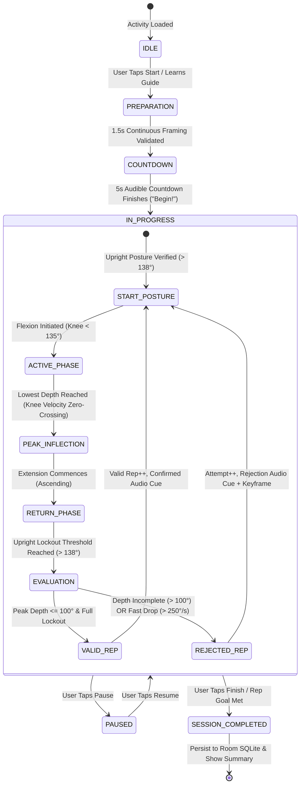

# Biomechanical Geometry & Finite State Machines

[Home](Home.md) · [System Architecture](System-Architecture-and-Pipeline.md) · [Biomechanical Geometry](Biomechanical-Geometry-and-FSM.md) · [Mobile Ergonomics](Mobile-Ergonomics-and-Touch-Architecture.md) · [Local Rehab Memory](Local-Rehab-Memory-and-Assistant.md) · [Clinician Portal & REST API](Clinician-Portal-and-Backend-API.md) · [Physical Validation & Testing](Physical-Validation-and-Troubleshooting.md)

---

KinexMed eliminates heuristic guesswork by evaluating movement kinematics deterministically through Euclidean 3D vector mathematics and stateful movement finite state machines.

---

## 1. Multi-Exercise Registry & Clinical Targets

The platform implements 15 clinical exercises across 4 therapeutic categories, each defined by explicit anatomical landmarks, target angles, camera framing distances, and validation badges:

| # | Exercise Name | Therapeutic Category | Primary Joint / Target | Valid Angle Range | Lockout Angle | Framing Distance | Validation Badge |
| :- | :--- | :--- | :--- | :--- | :--- | :--- | :--- |
| **1** | **Sit-to-Stand** | Lower Body | Knee & Hip Extension | $\ge 148^\circ$ | $160^\circ$ | 2.5 m (Side / 45°) | `PHYSICALLY_DEMONSTRATED` |
| **2** | **Bilateral Squat** | Lower Body | Knee Flexion (Sagittal) | $\le 100^\circ$ (Opt $90^\circ$) | $138^\circ$ | 2.5 m (Sagittal / Side) | `IMPLEMENTED_MODULE` |
| **3** | **Forward Lunge** | Lower Body | Lead Knee Flexion | $\le 100^\circ$ | $135^\circ$ | 2.5 m (Side view) | `IMPLEMENTED_MODULE` |
| **4** | **Reverse Lunge** | Lower Body | Lead Knee Flexion | $\le 100^\circ$ | $135^\circ$ | 2.5 m (Side view) | `IMPLEMENTED_MODULE` |
| **5** | **Calf Raise** | Lower Body | Ankle Plantarflexion | $\ge 115^\circ$ | $90^\circ$ | 2.0 m (Full Body) | `IMPLEMENTED_MODULE` |
| **6** | **Knee Extension** | Lower Body | Seated Tibial Extension | $\ge 145^\circ$ | $90^\circ$ | 2.0 m (Seated Side) | `IMPLEMENTED_MODULE` |
| **7** | **Hip Abduction** | Lower Body | Standing Lateral Raise | $\le 150^\circ$ | $175^\circ$ | 2.5 m (Frontal Coronal)| `IMPLEMENTED_MODULE` |
| **8** | **Hip Extension** | Lower Body | Standing Posterior Raise| $\le 152^\circ$ | $175^\circ$ | 2.5 m (Sagittal Side) | `IMPLEMENTED_MODULE` |
| **9** | **Shoulder Flexion**| Upper Body | Anterior Arm Elevation | $\ge 90^\circ$ | $30^\circ$ | 2.0 m (Sagittal Side) | `IMPLEMENTED_MODULE` |
| **10**| **Shoulder Abduction**| Upper Body | Lateral Arm Elevation | $\ge 90^\circ$ | $30^\circ$ | 2.0 m (Frontal Coronal)| `IMPLEMENTED_MODULE` |
| **11**| **Elbow Flexion** | Upper Body | Interior Bicep Curl | $\le 70^\circ$ | $145^\circ$ | 1.8 m (Frontal/Side) | `IMPLEMENTED_MODULE` |
| **12**| **Elbow Extension**| Upper Body | Tricep Extension | $\ge 145^\circ$ | $90^\circ$ | 1.8 m (Side view) | `IMPLEMENTED_MODULE` |
| **13**| **Marching in Place**| Functional | Alternating Hip Flexion | $\le 110^\circ$ | $165^\circ$ | 2.5 m (Frontal Coronal)| `IMPLEMENTED_MODULE` |
| **14**| **Heel-Toe Rocking**| Functional | Ankle Dynamic Range | $\ge 112^\circ$ | $90^\circ$ | 2.0 m (Side view) | `IMPLEMENTED_MODULE` |
| **15**| **Single-Leg Balance**| Balance | Hold Duration Ratio | $\ge 10.0\text{ seconds}$ | N/A | 2.5 m (Frontal Coronal)| `IMPLEMENTED_MODULE` |

---

## 2. 3D Biomechanical Geometry Engine

Joint angles are extracted using 3D Euclidean coordinates $(x, y, z)$ from MediaPipe Pose landmarks.

Given three joint landmarks forming an articulation:
- Vertex joint: $B$ (e.g. Knee)
- Proximal joint: $A$ (e.g. Hip)
- Distal joint: $C$ (e.g. Ankle)

Two vectors in $\mathbb{R}^3$ are defined:
$$\vec{u} = A - B, \quad \vec{v} = C - B$$

The interior Euclidean angle $\theta$ is calculated via dot product and vector norms:
$$\cos(\theta) = \frac{\vec{u} \cdot \vec{v}}{\|\vec{u}\| \|\vec{v}\|}$$
$$\theta = \arccos\left(\text{clamp}\left(\frac{\vec{u} \cdot \vec{v}}{\|\vec{u}\| \|\vec{v}\|}, -1.0, 1.0\right)\right) \times \frac{180^\circ}{\pi}$$

### Side-Preference Hysteresis (+-0.08 Confidence Margin)
When both left and right joints are partially visible to the camera, switching between sides frame-to-frame introduces angle instability. KinexMed implements confidence hysteresis:
```kotlin
val leftConfidence = (leftHip.visibility + leftKnee.visibility + leftAnkle.visibility) / 3f
val rightConfidence = (rightHip.visibility + rightKnee.visibility + rightAnkle.visibility) / 3f

val selectedSide = when (currentActiveSide) {
    BodySide.LEFT -> if (rightConfidence > leftConfidence + 0.08f) BodySide.RIGHT else BodySide.LEFT
    BodySide.RIGHT -> if (leftConfidence > rightConfidence + 0.08f) BodySide.LEFT else BodySide.RIGHT
    null -> if (leftConfidence >= rightConfidence) BodySide.LEFT else BodySide.RIGHT
}
```

---

## 3. Finite State Machine (FSM) Lifecycle

Every exercise implements the `ExerciseStateMachine` interface, managing distinct movement states and enforcing evidence validation:



---

## 4. Evidence Gate: Refusal to Guess

The `EvidenceEngine` operates as a gatekeeper before every kinematic calculation:

1. **Containment Inspection:** All key bounding landmarks (head, shoulders, hips, knees, ankles) must reside within 5% to 95% of the frame bounds.
2. **Confidence Threshold:** Landmark detection confidence must exceed `0.65`.
3. **Camera Distance Verification:** Inter-ankle to shoulder vertical span must match expected optical proportions for `2.0m–2.5m` distance.
4. **Failure Logging:** When an evidence failure occurs, an `EvidenceEventEntity` is immediately created in Room SQLite recording the timestamp, metric, and exact cause (e.g. `OCCLUDED_KNEE`, `OUT_OF_FRAME`, `TOO_CLOSE`). Repetitions are never scored while in evidence failure.

---

## 5. Decoupled Pose Analysis Controller

The kinematic calculations, One-Euro filtering, and FSM transition loops are encapsulated inside `PoseAnalysisController.kt` (`com.kinexmed.domain.controller`), decoupling algorithmic execution from the Android UI thread and activity lifecycle:

- **State Encapsulation:** Holds active exercise definition, One-Euro filter instances, and the stateful `ExerciseStateMachine`.
- **Episode Aggregation:** Tracks occlusion periods (`EvidenceEpisode`) without discarding the ongoing repetition state.
- **Headless Unit Verification:** Decoupled design allows full testing of joint angle calculations and state transitions without initializing Android Views or CameraX hardware (verified in `PoseAnalysisControllerTest.kt`).

---

**Navigation:** [Home](Home.md) | [Architecture](System-Architecture-and-Pipeline.md) | [Biomechanics & FSM](Biomechanical-Geometry-and-FSM.md) | [Mobile Ergonomics](Mobile-Ergonomics-and-Touch-Architecture.md) | [Rehab Memory](Local-Rehab-Memory-and-Assistant.md) | [Clinician API & Portal](Clinician-Portal-and-Backend-API.md) | [Physical Validation](Physical-Validation-and-Troubleshooting.md)
