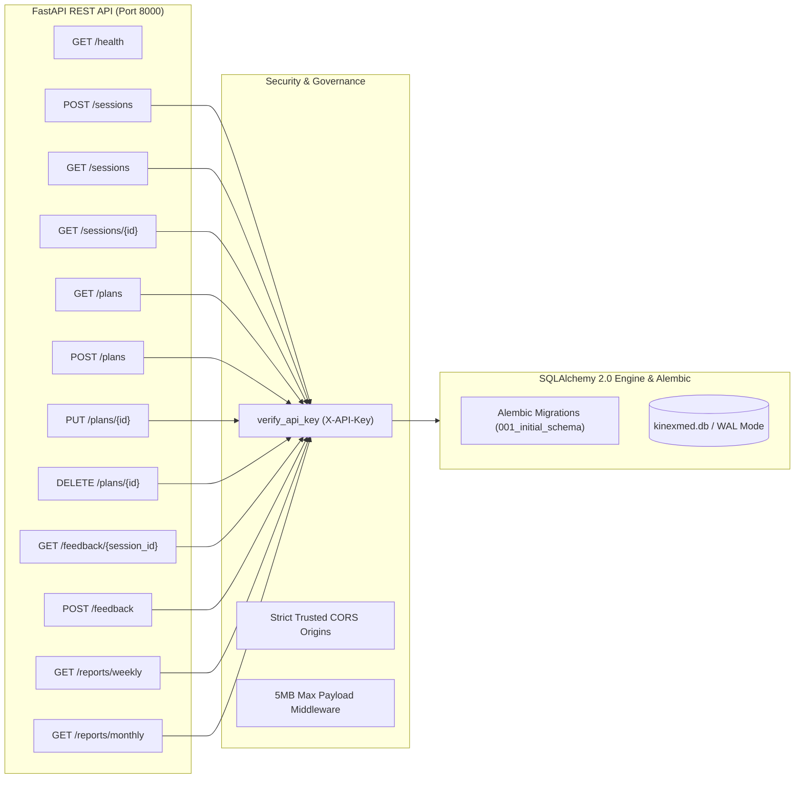
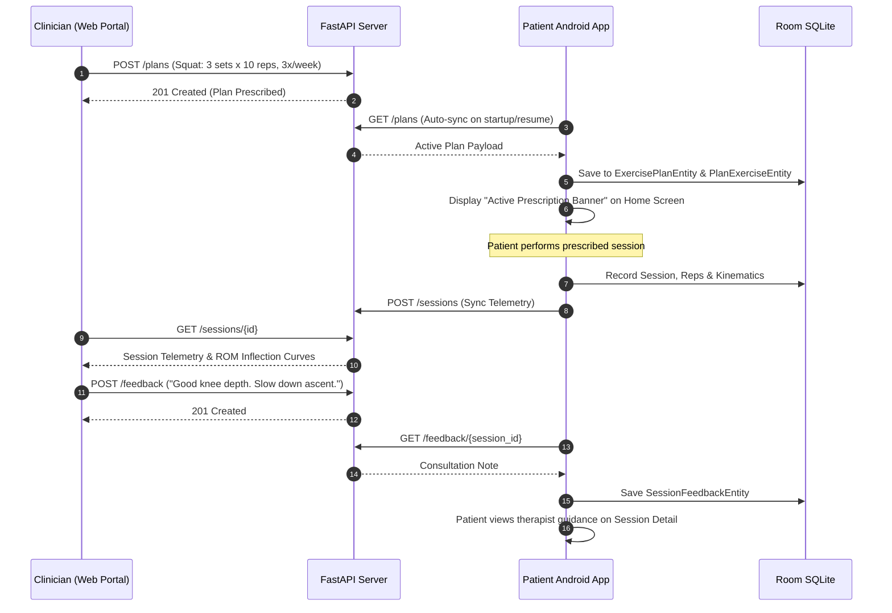

# Clinician Portal & REST API Backend

[Home](Home.md) · [System Architecture](System-Architecture-and-Pipeline.md) · [Biomechanical Geometry](Biomechanical-Geometry-and-FSM.md) · [Mobile Ergonomics](Mobile-Ergonomics-and-Touch-Architecture.md) · [Rehab Memory](Local-Rehab-Memory-and-Assistant.md) · [Clinician Portal & REST API](Clinician-Portal-and-Backend-API.md) · [Physical Validation & Testing](Physical-Validation-and-Troubleshooting.md)

---

KinexMed provides an asynchronous FastAPI backend and a React clinician dashboard for physical therapists to monitor patient rehabilitation between clinic appointments.

---

## 1. Backend REST API Architecture

The FastAPI service (`backend/app/`) runs asynchronously on Python 3.10+ using SQLAlchemy 2.0 with SQLite/PostgreSQL storage, enforced WAL pragmas, and versioned Alembic migrations.

### Endpoints Specification

| Method | Endpoint | Description | Input / Parameters | Response Status | Security Gate |
| :--- | :--- | :--- | :--- | :--- | :--- |
| `GET` | `/` | Service health status | None | `200 OK` | Public |
| `POST` | `/sessions` | Idempotent session ingestion | `SessionPayload` (JSON) | `200 OK` / `201 Created` | `X-API-Key` (when configured) |
| `GET` | `/sessions` | List sessions with filters | `device_id`, `exercise_name`, `limit` | `200 OK` (JSON List) | `X-API-Key` (when configured) |
| `GET` | `/sessions/{id}` | Detailed session telemetry | `id` (path) | `200 OK` / `404 Not Found` | `X-API-Key` (when configured) |
| `GET` | `/plans` | Retrieve exercise regimens | `patient_id`, `is_active` | `200 OK` (JSON List) | `X-API-Key` (when configured) |
| `POST` | `/plans` | Create prescribed plan | `PlanCreatePayload` | `201 Created` | `X-API-Key` (when configured) |
| `PUT` | `/plans/{id}` | Update prescribed plan | `id` (path), `PlanUpdatePayload` | `200 OK` | `X-API-Key` (when configured) |
| `DELETE`| `/plans/{id}` | Deactivate plan | `id` (path) | `200 OK` | `X-API-Key` (when configured) |
| `GET` | `/feedback/{session_id}` | Consultation notes thread | `session_id` (path) | `200 OK` (JSON List) | `X-API-Key` (when configured) |
| `POST` | `/feedback` | Post clinician note | `FeedbackCreatePayload` | `201 Created` | `X-API-Key` (when configured) |
| `GET` | `/reports/weekly` | Aggregate compliance report| `start_date`, `end_date` | `200 OK` (Markdown/Text) | `X-API-Key` (when configured) |
| `GET` | `/reports/monthly` | Longitudinal progress summary| `month`, `year` | `200 OK` (Markdown/Text) | `X-API-Key` (when configured) |

---

## 2. Database Versioning & Alembic Migrations

To maintain production reproducibility and schema integrity:
- **Alembic Configuration (`backend/alembic.ini`):** Defines database migration scripts under `backend/alembic/versions/`.
- **Baseline Migration (`001_initial_schema.py`):** Encapsulates the entire relational schema: `sessions`, `session_reps`, `session_evidence_events`, `exercise_plans`, `plan_exercises`, and `session_feedback`.
- **Composite Indexing:** Configures composite query indexes (`ix_sessions_device_started` and `ix_sessions_exercise_created`) for high-throughput chronological time-series retrieval.
- **Automated Startup Lifespan:** `run_migrations()` in `backend/app/core/database.py` executes on FastAPI application startup, stamping pre-existing unversioned SQLite tables or applying pending migrations to ensure zero runtime collisions.
- **SQLite Concurrency & Integrity:** Enforces Write-Ahead Logging (`PRAGMA journal_mode=WAL`) and cascading foreign key constraints (`PRAGMA foreign_keys=ON`) upon every database engine connection.

---

## 3. Security Posture & API Protection

1. **Authentication Gate:** The `verify_api_key` security dependency enforces `X-API-Key` credentials on protected endpoints when `KINEXMED_API_KEY` is set in the runtime environment.
2. **CORS Least Privilege:** Replaces permissive wildcards with explicit whitelisted origins (`http://localhost:5173`, `http://127.0.0.1:5173`, `http://localhost:3000`, `http://127.0.0.1:8000`).
3. **Payload Ceiling Middleware:** Rejects incoming payloads exceeding 5 MB with HTTP 413 to prevent memory exhaustion and denial-of-service vectors.
4. **Non-Root Docker Execution:** The production `backend/Dockerfile` builds a lightweight image executing under unprivileged user `appuser:10001`.

---

## 4. Prescribed Plan & Clinician Feedback Loop

The platform bridges clinician prescription and patient execution through a closed feedback loop:

---

## 5. Clinician Web Dashboard & Vitest Test Coverage

The web dashboard (`web/src/`) provides therapists with an intuitive, data-dense interface:
1. **Overview View (`OverviewView.tsx`):** Displays real-time session feed, aggregate adherence percentages, and sync statuses.
2. **Session Detail View (`SessionDetailView.tsx`):** Visualizes repetition-by-repetition inflection points, min/max flexion angles, velocity limits, and evidence violation causes.
3. **Prescription Builder (`PlansView.tsx`):** Allows therapists to select from the 15 exercises, adjust target depth thresholds, configure sets/reps, and activate plans.
4. **Adherence Reports (`ReportsView.tsx`):** Formats weekly and monthly adherence summaries with one-tap clipboard copy for electronic health record (EHR) entry.
5. **Honest Empty State (`EmptyState.tsx`):** When no physical device has synchronized, the portal displays a genuine empty state guiding the therapist on connecting a phone, rather than rendering fabricated dummy graphs.
6. **Error Boundary Fallback (`ErrorBoundary.tsx`):** Isolates rendering exceptions in telemetry widgets, preventing white-screen portal crashes and preserving patient session data.
7. **Vitest Unit & Component Tests (`web/src/__tests__/`):**
   - `ErrorBoundary.test.tsx`: Validates error catching, alert banner presentation, and recovery button interactions.
   - `EmptyState.test.tsx`: Asserts privacy guarantees and setup instructions.
   - `KpiCards.test.tsx`: Verifies accurate mathematical computation of valid rep ratios, average peak ROM, and evidence failure metrics.

---

**Navigation:** [Home](Home.md) | [Architecture](System-Architecture-and-Pipeline.md) | [Biomechanics & FSM](Biomechanical-Geometry-and-FSM.md) | [Mobile Ergonomics](Mobile-Ergonomics-and-Touch-Architecture.md) | [Rehab Memory](Local-Rehab-Memory-and-Assistant.md) | [Clinician API & Portal](Clinician-Portal-and-Backend-API.md) | [Physical Validation](Physical-Validation-and-Troubleshooting.md)
