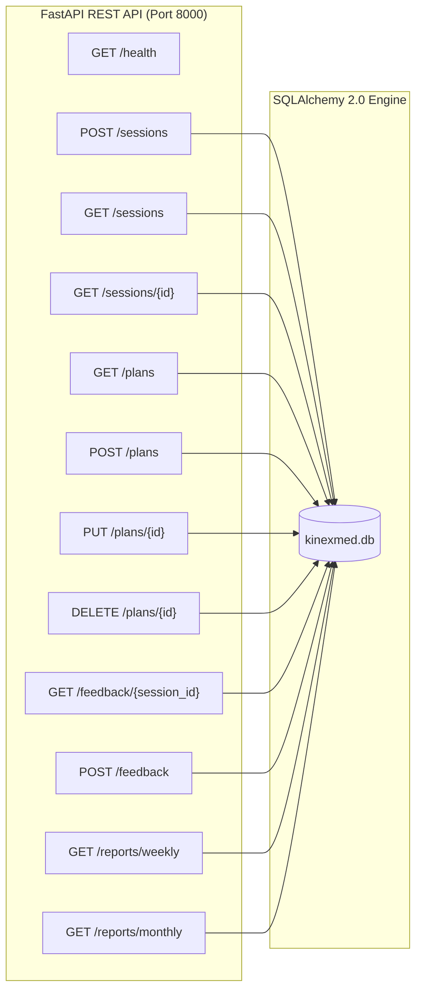
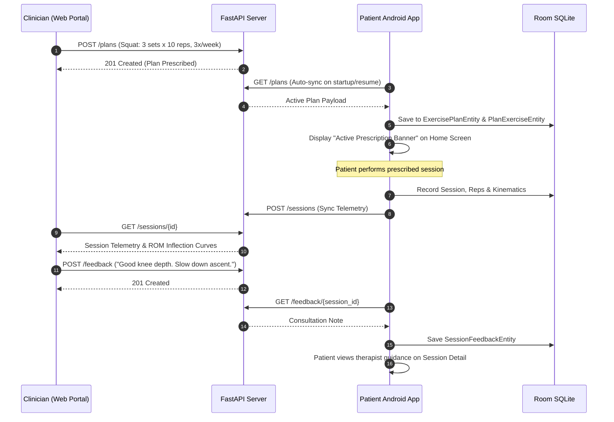

# Clinician Portal & REST API Backend

KinexMed provides an asynchronous FastAPI backend and a React clinician dashboard for physical therapists to monitor patient rehabilitation between clinic appointments.

---

## 1. Backend REST API Architecture

The FastAPI service (`backend/app/`) runs asynchronously on Python 3.10+ using SQLAlchemy 2.0 with SQLite/PostgreSQL storage.

### Endpoints Specification

| Method | Endpoint | Description | Input / Parameters | Response Status |
| :--- | :--- | :--- | :--- | :--- |
| `GET` | `/health` | Service health status | None | `200 OK` |
| `POST` | `/sessions` | Idempotent session ingestion | `SessionPayload` (JSON) | `200 OK` / `201 Created` |
| `GET` | `/sessions` | List sessions with filters | `device_id`, `exercise_name`, `limit` | `200 OK` (JSON List) |
| `GET` | `/sessions/{id}` | Detailed session telemetry | `id` (path) | `200 OK` / `404 Not Found` |
| `GET` | `/plans` | Retrieve exercise regimens | `patient_id`, `is_active` | `200 OK` (JSON List) |
| `POST` | `/plans` | Create prescribed plan | `PlanCreatePayload` | `201 Created` |
| `PUT` | `/plans/{id}` | Update prescribed plan | `id` (path), `PlanUpdatePayload` | `200 OK` |
| `DELETE`| `/plans/{id}` | Deactivate plan | `id` (path) | `200 OK` |
| `GET` | `/feedback/{session_id}` | Consultation notes thread | `session_id` (path) | `200 OK` (JSON List) |
| `POST` | `/feedback` | Post clinician note | `FeedbackCreatePayload` | `201 Created` |
| `GET` | `/reports/weekly` | Aggregate compliance report| `start_date`, `end_date` | `200 OK` (Markdown/Text) |
| `GET` | `/reports/monthly` | Longitudinal progress summary| `month`, `year` | `200 OK` (Markdown/Text) |

---

## 2. Prescribed Plan & Clinician Feedback Loop

The platform bridges clinician prescription and patient execution through a closed feedback loop:

---

## 3. Clinician Web Dashboard (Zero-Mock React + Vite)

The web dashboard (`web/src/`) provides therapists with an intuitive, data-dense interface:
1. **Overview View (`OverviewView.tsx`):** Displays real-time session feed, aggregate adherence percentages, and sync statuses.
2. **Session Detail View (`SessionDetailView.tsx`):** Visualizes repetition-by-repetition inflection points, min/max flexion angles, velocity limits, and evidence violation causes.
3. **Prescription Builder (`PlansView.tsx`):** Allows therapists to select from the 15 exercises, adjust target depth thresholds, configure sets/reps, and activate plans.
4. **Adherence Reports (`ReportsView.tsx`):** Formats weekly and monthly adherence summaries with one-tap clipboard copy for electronic health record (EHR) entry.
5. **Honest Empty State (`EmptyState.tsx`):** When no physical device has synchronized, the portal displays a genuine empty state guiding the therapist on connecting a phone, rather than rendering fabricated dummy graphs.
