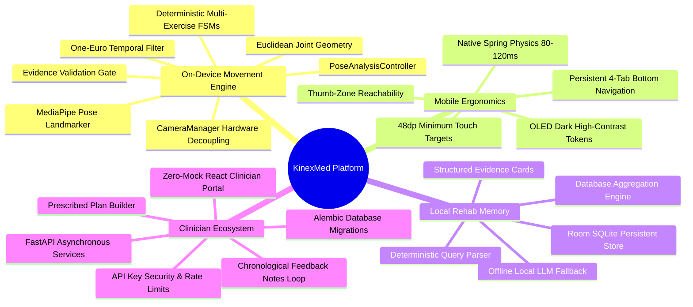

# KinexMed Platform Documentation Wiki

[Home](Home.md) · [System Architecture](System-Architecture-and-Pipeline.md) · [Biomechanical Geometry](Biomechanical-Geometry-and-FSM.md) · [Mobile Ergonomics](Mobile-Ergonomics-and-Touch-Architecture.md) · [Local Rehab Memory](Local-Rehab-Memory-and-Assistant.md) · [Clinician Portal & REST API](Clinician-Portal-and-Backend-API.md) · [Physical Validation & Testing](Physical-Validation-and-Troubleshooting.md)

---

Welcome to the official technical wiki for **KinexMed**, an edge-native physical rehabilitation platform enabling real-time biomechanical movement analysis, local-first conversational rehabilitation memory, and structured clinician oversight.

---

## 1. Platform Overview & Vision

KinexMed solves the adherence and verification problem in remote physical rehabilitation. Patients prescribed home physical therapy often struggle with incorrect form, lack of objective feedback, and disconnect from their therapist. Traditional solutions either require proprietary wearable sensors or upload privacy-invasive full video streams to cloud servers.

KinexMed runs **100% on-device vision processing** on standard Android smartphones, extracting 33 3D anatomical landmarks at ~28 FPS using Google MediaPipe Pose on CPU. Joint angles are evaluated deterministically through Euclidean geometry and finite state machines (FSMs), delivering sub-millisecond audio and visual coaching without transmitting video off the handset.

---

## 2. Core Architectural Tenets

1. **Strict Zero-Mock Data Integrity:** Every angle, repetition count, velocity measurement, and evidence failure recorded in KinexMed originates solely from live on-device anatomical landmark geometry. No simulated data is hardcoded into runtime databases.
2. **Privacy by Design (Zero Video Upload):** Camera frames are analyzed in transient RAM buffers and released immediately. No continuous video or photos are saved or uploaded to remote servers. Only lightweight mathematical telemetry (JSON) leaves the device.
3. **Deterministic Movement Analysis:** Artificial intelligence is used exclusively for spatial landmark estimation and natural language explanation. Physical movement counting, phase transitions, and form validation are governed strictly by deterministic geometry and finite state machines to eliminate hallucinated rep counts.
4. **Offline Autonomy:** Patients can perform workouts completely offline. All session data, individual repetitions, and evidence events persist in local Room SQLite and automatically synchronize when an authorized clinician network is detected.
5. **Database Versioning & Migration Safety:** Backend database schemas are fully version-controlled using Alembic migrations with automatic lifespan synchronization and legacy schema stamping, replacing unversioned automatic table generation.
6. **Decoupled Architecture & Layered Testing:** Android hardware lifecycle is decoupled into dedicated camera and kinematics controllers. Full multi-platform test coverage spans 50 backend/Playwright E2E tests, 32 Android unit tests, and 5 React Vitest component tests.
7. **Non-Diagnostic Safety Boundaries:** KinexMed is an assistive observation and adherence tool between clinical consultations. It does not diagnose medical conditions or independently prescribe pharmacological treatments.

---

## 3. Wiki Navigation Index

| Topic | Document | Key Technical Contents |
| :--- | :--- | :--- |
| **System Architecture & Pipeline** | [System Architecture](System-Architecture-and-Pipeline.md) | 10-stage processing pipeline, CameraManager, PoseAnalysisController, latency instrumentation |
| **Biomechanical Geometry & FSM** | [Biomechanical Geometry](Biomechanical-Geometry-and-FSM.md) | 15 exercise definitions, 3D Euclidean angles, side-preference hysteresis, state transitions |
| **Mobile UX & Ergonomics** | [Mobile Ergonomics](Mobile-Ergonomics-and-Touch-Architecture.md) | Thumb-zone reachability, 48dp touch targets, OLED dark theme tokens, spring physics |
| **Local Rehab Memory & Assistant** | [Local Rehab Memory](Local-Rehab-Memory-and-Assistant.md) | Room SQLite retrieval, deterministic parser, SQL aggregation, structured evidence cards |
| **Clinician Portal & REST API** | [Clinician Portal & API](Clinician-Portal-and-Backend-API.md) | FastAPI endpoints, Alembic migrations, API key auth, React dashboard, Vitest component tests |
| **Physical Validation & Testing** | [Physical Validation Guide](Physical-Validation-and-Troubleshooting.md) | Physical test runbooks, camera distance, lighting, squat debugging, test automation matrix |

---

**Navigation:** [Home](Home.md) | [Architecture](System-Architecture-and-Pipeline.md) | [Biomechanics & FSM](Biomechanical-Geometry-and-FSM.md) | [Mobile Ergonomics](Mobile-Ergonomics-and-Touch-Architecture.md) | [Rehab Memory](Local-Rehab-Memory-and-Assistant.md) | [Clinician API & Portal](Clinician-Portal-and-Backend-API.md) | [Physical Validation](Physical-Validation-and-Troubleshooting.md)
