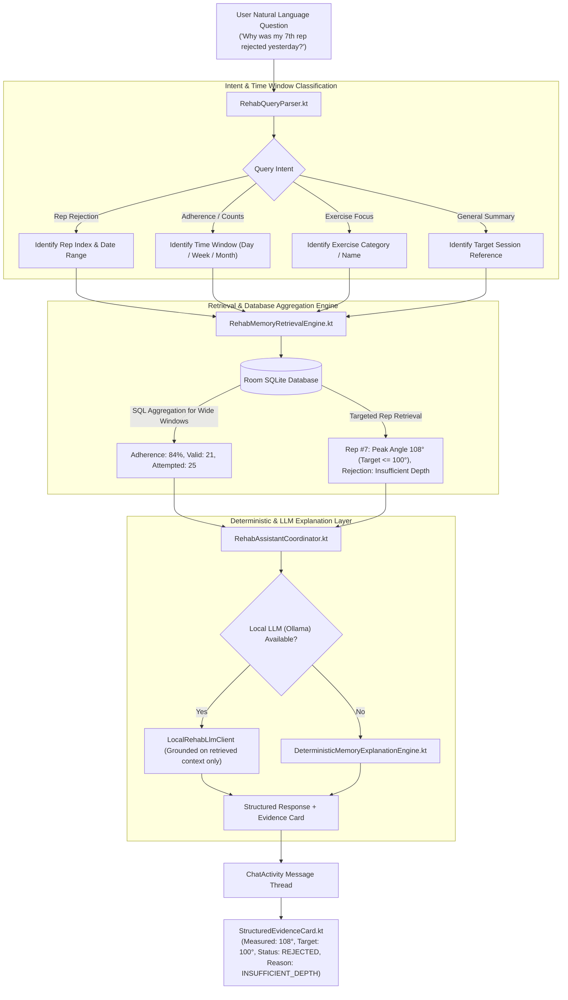

# Local Rehabilitation Memory & Conversational Assistant

[Home](Home.md) · [System Architecture](System-Architecture-and-Pipeline.md) · [Biomechanical Geometry](Biomechanical-Geometry-and-FSM.md) · [Mobile Ergonomics](Mobile-Ergonomics-and-Touch-Architecture.md) · [Local Rehab Memory](Local-Rehab-Memory-and-Assistant.md) · [Clinician Portal & REST API](Clinician-Portal-and-Backend-API.md) · [Physical Validation & Testing](Physical-Validation-and-Troubleshooting.md)

---

KinexMed incorporates a local-first conversational rehabilitation memory layer. Patients can query their historical kinematic sessions, rejection causes, and adherence metrics in plain natural language.

---

## 1. Local-First Memory Architecture

Room SQLite serves as the persistent memory layer on flash storage. Large language models (LLMs) are **never treated as the database** and never receive raw camera frames or full-session video recordings. Instead, a retrieval engine extracts structured evidence and SQL aggregations into a strictly bounded context.



---

## 2. Structured Evidence Cards

When answering queries about specific repetitions or session outcomes, KinexMed does not output generic conversational prose alone. It renders an actionable `StructuredEvidenceCard`:

```
+-----------------------------------------------------------+
| REPETITION EVIDENCE CARD: Rep #7                          |
| Bilateral Squat - 2026-09-22 10:14:32                     |
+-----------------------------------------------------------+
| Status:           REJECTED                                |
| Measured Angle:   108.4 deg                               |
| Target Depth:     <= 100.0 deg (Optimal 90.0 deg)         |
| Variance:         +8.4 deg above threshold                |
| Primary Cause:    INSUFFICIENT_DEPTH                      |
| Duration:         2.4 seconds                             |
| Session ID:       session-real-1726960000000              |
| Frame Reference:  evidence_rep7_1726960045000.jpg         |
+-----------------------------------------------------------+
| [ View Full Session ]          [ Practice This Exercise ] |
+-----------------------------------------------------------+
```

Tapping the card navigates directly to the session in `SessionHistoryActivity` or launches the relevant instruction guide in `ExerciseDetailActivity`.

---

## 3. Database Aggregation vs Context Budget

To guarantee predictable latency and prevent token budget exhaustion on local devices:
- **Wide Date Ranges (Week / Month / All-time):** Handled via SQL `COUNT(*)`, `SUM(valid_reps)`, `AVG(duration_seconds)`. Only numerical summaries are fed to the explanation layer.
- **Single Session / Specific Rep:** Retrieved by direct primary key query (`sessionId`, `repNumber`).
- **Hallucination Prevention:** The explanation prompt strictly forbids diagnosing medical conditions, inventing unrecorded angles, or asserting clinical improvement. If no data exists, it states: *"No sessions recorded for that timeframe."*

---

## 4. Prompt Injection Sanitization & Security Boundaries

In physical rehabilitation contexts, adversarial or malformed user prompts must never cause the on-device assistant to alter clinical records or execute unauthorized actions:

- **Input Sanitization:** Strips Markdown headings, block delimiters, and prompt override tokens (`<system>`, `ignore previous instructions`).
- **Bounded Input Window:** Restricts user prompt queries to a maximum of 500 characters, preventing prompt injection overflow attacks.
- **Strict Role-Grounded System Prompt:** The system prompt binds model responses strictly to the retrieved SQL evidence context. If requested information is outside the retrieved rehabilitation session data, the model returns a deterministic fallback: *"I can only answer questions regarding your recorded rehabilitation sessions."*

---

**Navigation:** [Home](Home.md) | [Architecture](System-Architecture-and-Pipeline.md) | [Biomechanics & FSM](Biomechanical-Geometry-and-FSM.md) | [Mobile Ergonomics](Mobile-Ergonomics-and-Touch-Architecture.md) | [Rehab Memory](Local-Rehab-Memory-and-Assistant.md) | [Clinician API & Portal](Clinician-Portal-and-Backend-API.md) | [Physical Validation](Physical-Validation-and-Troubleshooting.md)
