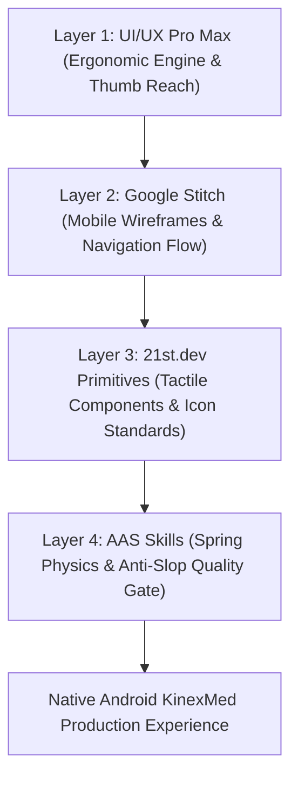
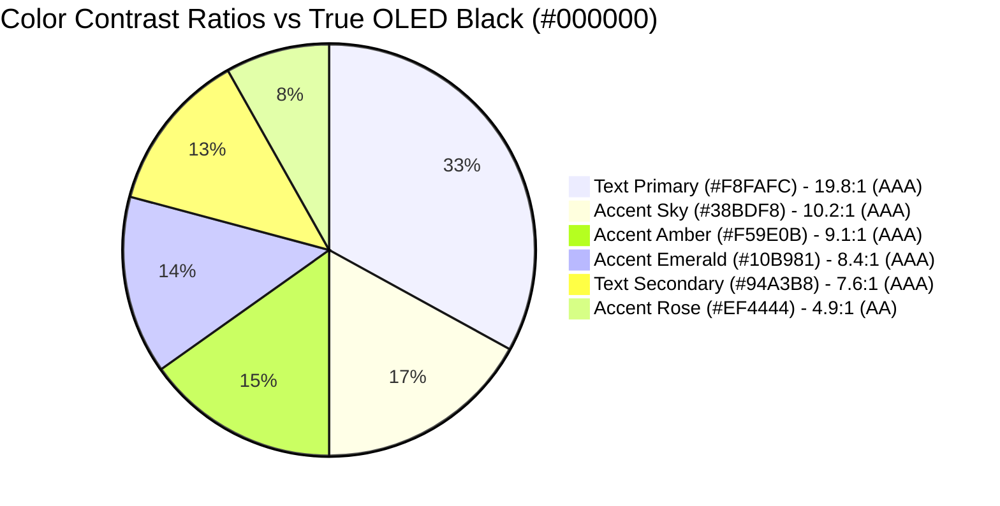

# Mobile UX Architecture & Native Ergonomics

KinexMed is built strictly for hand-held physical ergonomics, eliminating desktop-biased web paradigms and prioritizing mobile thumb-zone reachability, touch target standards, and native spring physics.

---

## 1. The 4-Layer Mobile Ergonomic Architecture



### Layer 1: Mobile Engine & Thumb-Zone Ergonomics
- **Touch Target Minimum:** Enforces $\ge 48 \times 48\text{ dp}$ on Android (`Modifier.minimumInteractiveComponentSize()`) and $\ge 44 \times 44\text{ pt}$ on iOS.
- **Hit-Slop Expansion:** Sub-48dp icon assets expand hit boundaries with minimum `8dp–12dp` outer margins.
- **Safe Area Inset Buffers:** Dynamic padding clearing status bars (`24–44dp`), dynamic island/notches (`47–59pt`), and gesture navigation indicators (`16–34dp`).
- **Bezel Exclusion:** No interactive swipe controls within `24dp` of display edges, preventing gesture conflict with Android and iOS system back navigation.

---

## 2. Thumb-Zone Reachability Layout

On tall mobile displays (19.5:9 aspect ratios), single-handed thumb reachability maps directly to screen hierarchy:

```
+-----------------------------------+  [0% - 15% Viewport Height]
|  Status Bar Clearances            |  EXTREME REACH ZONE
|  Read-Only Branding & Subtitle    |  - Informative only
|  btnHistory & btnSettings (48dp)  |  - High-elevation utility buttons
+-----------------------------------+  [15% - 55% Viewport Height]
|                                   |  NEUTRAL / PINCH ZONE
|  CameraX Live Preview (YUV_420)   |  - Camera optical viewport
|  PoseOverlayView 3D Skeleton Arc  |  - Non-touch visual telemetry
|  Weekly Adherence Charts          |  - Passive metrics readout
|                                   |
+-----------------------------------+  [55% - 85% Viewport Height]
|  Exercise Selection Cards         |  NATURAL THUMB COMFORT ZONE
|  Category Filter Chips (48dp)     |  - 85% of physical interactions
|  Rep Count & Form Quality HUD     |  - High-frequency buttons
|  Start Tracking CTA (48dp)        |  - Instant thumb reachability
+-----------------------------------+  [85% - 100% Viewport Height]
|  Persistent Bottom Navigation Bar |  INSTANT REACH ZONE
|  (Exercises | Plans | Progress |  |  - 4 tabs max with 48dp hit targets
|   Assistant)                      |  - Safe-area bottom inset buffer
+-----------------------------------+
```

---

## 3. High-Contrast OLED Theming (WCAG AAA)

Mobile physical therapy requires clear outdoor and low-light clinic legibility. KinexMed uses true OLED black (`#000000`) for zero-pixel power drain on AMOLED displays and high-contrast semantic tokens:



| Semantic Token | Hex Value | Contrast vs `#000000` | Ergonomic Role |
| :--- | :--- | :--- | :--- |
| `oled_base` | `#000000` | Baseline | Canvas background |
| `surface_elevated` | `#121A2D` | 1.5:1 | Bottom navigation bar & app header |
| `card_surface` | `#1A233A` | 2.2:1 | Exercise card background |
| `border_subtle` | `rgba(255,255,255,0.08)` | N/A | Structural division |
| `text_primary` | `#F8FAFC` | **19.8:1** | Headings, joint angle readouts, primary values |
| `text_secondary` | `#94A3B8` | **7.6:1** | Instructions, timestamps, metadata |
| `accent_sky` | `#38BDF8` | **10.2:1** | Live joint angle arc overlay |
| `accent_emerald` | `#10B981` | **8.4:1** | Valid rep confirmation & demonstrated badges |
| `accent_amber` | `#F59E0B` | **9.1:1** | In-progress movement & form warnings |
| `accent_rose` | `#EF4444` | **4.9:1** | Evidence gate violations & incomplete depth |

---

## 4. Native Spring Physics & Tactile Haptics

KinexMed replaces jarring web-like instant transitions with physics-based spring dampening implemented via `TouchErgonomicsHelper.kt`:

- **Touch Down (80 ms):** Scale down to `0.96` with native haptic pulse (`HapticFeedbackConstants.VIRTUAL_KEY`).
- **Release / Cancel (120 ms):** Natural spring rebound back to `1.0` scale.
- **Repetition Confirmation:** Distinct confirmation tick (`HapticFeedbackConstants.KEYBOARD_TAP`).
- **Evidence Gate Violation:** Heavy long press tick (`HapticFeedbackConstants.LONG_PRESS`).

```kotlin
// Android TouchErgonomicsHelper implementation
fun attachSpringPress(view: View) {
    view.setOnTouchListener { v, event ->
        when (event.action) {
            MotionEvent.ACTION_DOWN -> {
                v.performHapticFeedback(HapticFeedbackConstants.VIRTUAL_KEY)
                v.animate().scaleX(0.96f).scaleY(0.96f).setDuration(80).start()
                false // Preserves Android standard click & accessibility dispatch
            }
            MotionEvent.ACTION_UP, MotionEvent.ACTION_CANCEL -> {
                v.animate().scaleX(1.0f).scaleY(1.0f).setDuration(120).start()
                false
            }
            else -> false
        }
    }
}
```

---

## 5. Mobile Anti-Slop Discipline Checklist

- [x] **No Desktop Scrollbars:** All scrollable containers enforce `android:scrollbars="none"` or `showsVerticalScrollIndicator={false}`.
- [x] **Zero Hover Dependencies:** Every tooltip or action trigger operates on direct touch down or tap.
- [x] **Flexible Viewport Bounds:** Card widths adapt dynamically (`maxWidth: 412dp` or constraint margins); zero horizontal clipping on narrow displays.
- [x] **Reduced Motion Accessibility:** All animations check system `prefers-reduced-motion` and collapse durations when enabled.
- [x] **Persistent Navigation State:** Bottom navigation tabs retain scroll positions and view models across tab switches.
