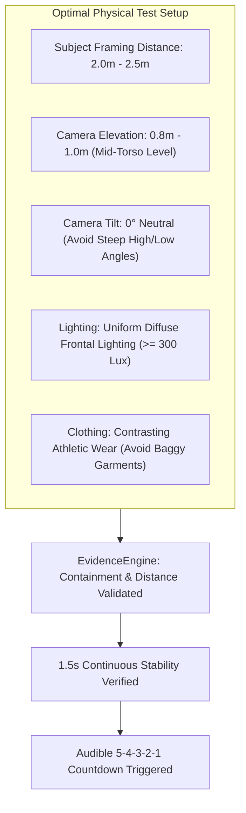
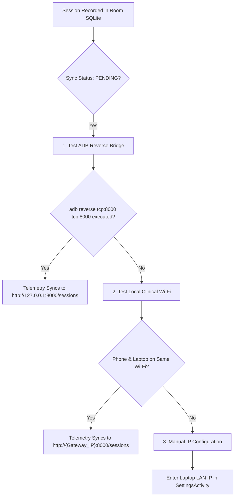

# Physical Validation & Troubleshooting Guide

This guide establishes the physical test runbooks, camera positioning criteria, and debugging protocols for KinexMed on physical Android hardware.

---

## 1. Camera Positioning & Optical Environment

Computer vision pose estimation depends directly on optical clarity, subject distance, and camera perspective:



### Optical Rules by Exercise
- **Sit-to-Stand:** Position camera at `45°` oblique or pure `90°` sagittal side view at `2.5m`. Clear space behind chair.
- **Bilateral Squat:** Position camera strictly in the `90°` sagittal (side) plane at `2.5m`. Ensures accurate knee flexion angle measurement.
- **Arm Elevation (Shoulder Flexion/Abduction):** Position camera at `2.0m` with clear ceiling clearance for full overhead extension.
- **Floor Exercises / Lunges:** Ensure floor surface and feet are within the bottom 10% bounding frame limit.

---

## 2. Bilateral Squat Debugging Protocol

During physical testing, bilateral squats may encounter rep-counting friction due to upright lockout criteria or side switching. Follow this recalibration protocol:

1. **Verify Lockout Angle:** KinexMed requires standing upright to $> 138^\circ$ knee extension before the FSM transitions to `START_POSTURE`. If the patient remains slightly crouched ($130^\circ$), the state machine will not arm for the next repetition.
2. **Side Switching Jitter:** Ensure the camera has an unobstructed view of one primary side. Side-preference hysteresis requires a `+0.08` confidence difference to switch legs; keep the dominant leg facing the camera lens.
3. **Descent Velocity Check:** Dropping faster than `250°/second` triggers an `UNCONTROLLED_VELOCITY` rejection. Emphasize a controlled 2-second descent.
4. **Inflection Zero-Crossing:** The FSM detects peak depth when knee angular velocity crosses zero and begins increasing. Pausing at the bottom for 0.5s guarantees clean inflection detection.

---

## 3. Network Sync Troubleshooting



### Quick Commands

```bash
# Verify ADB connection
adb devices

# Re-enable port forwarding for FastAPI server
adb reverse tcp:8000 tcp:8000

# View live Android telemetry logs
adb logcat -s KinexMed EvidenceEngine ExerciseStateMachine SyncManager
```

---

## 4. Automated Verification Commands

Before deploying or physically demonstrating, verify the complete automated test suite:

```bash
# 1. Backend REST & Kinematics Tests (39 passing tests)
d:\KinexMed\backend\.venv\Scripts\python.exe -m pytest backend/tests -v

# 2. Android Unit & Consistency Tests (28 passing tests)
cmd /c "set JAVA_HOME=D:\KinexMed\android\.jdk17\jdk-17.0.12+7&& cd /d D:\KinexMed\android&& gradlew.bat testDebugUnitTest"

# 3. Web Dashboard Production Build
cd web && npm run build
```
