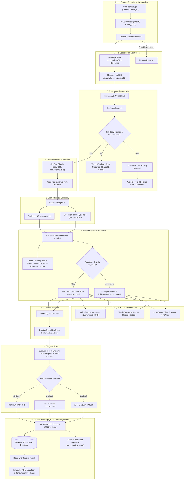
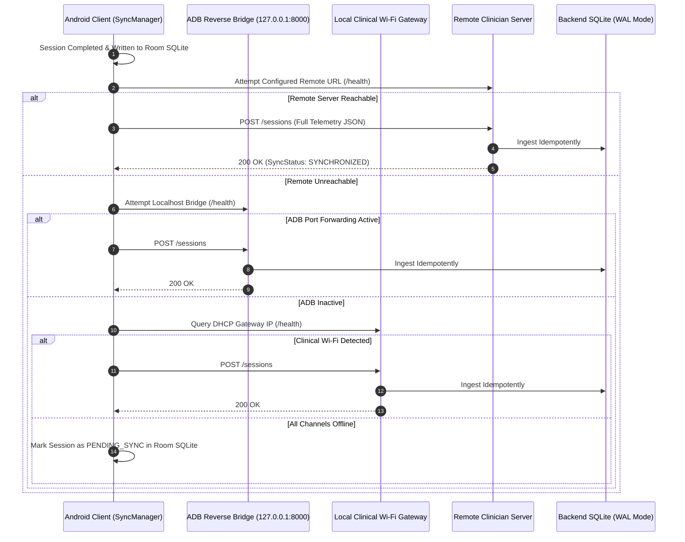

# System Architecture & Processing Pipeline

[Home](Home.md) · [System Architecture](System-Architecture-and-Pipeline.md) · [Biomechanical Geometry](Biomechanical-Geometry-and-FSM.md) · [Mobile Ergonomics](Mobile-Ergonomics-and-Touch-Architecture.md) · [Rehab Memory](Local-Rehab-Memory-and-Assistant.md) · [Clinician API & Portal](Clinician-Portal-and-Backend-API.md) · [Physical Validation & Testing](Physical-Validation-and-Troubleshooting.md)

---

KinexMed implements an edge-native, 10-stage processing pipeline that transforms raw camera photons into validated kinematic metrics and clinician dashboards.

---

## 1. End-to-End Processing Pipeline

---

## 2. Decoupled Android Subsystem Architecture

To prevent monolithic Activity degradation, camera hardware and kinematic evaluation are partitioned into specialized controllers:

1. **`CameraManager.kt` (`com.kinexmed.camera`):**
   - Encapsulates CameraX `ProcessCameraProvider` binding, `PreviewView` surface provider attachment, and `ImageAnalysis` analyzer loop.
   - Executes image buffer transformation and rotation matrix correction on a dedicated background single-thread executor.
   - Protects UI from camera lifecycle leaks via explicit `shutdown()` hooks.

2. **`PoseAnalysisController.kt` (`com.kinexmed.domain.controller`):**
   - Decouples biomechanical evaluation, One-Euro filtering, and FSM dispatch from Activity UI rendering.
   - Aggregates transient visual occlusion into structured `EvidenceEpisode` records without discarding session state.
   - Provides clean headless unit testability verified via `PoseAnalysisControllerTest.kt`.

---

## 3. Latency Budget & Phase Performance

All processing stages operate on-device to maintain an overall frame latency well below human perception:

| Pipeline Stage | Module | Typical Latency | Budget Target | Implementation Method |
| :--- | :--- | :--- | :--- | :--- |
| **Image Analysis** | `CameraManager` | 3.2 ms | <= 5.0 ms | Zero-copy direct buffer handling |
| **Pose Estimation** | `PoseLandmarkerHelper` | 32.0 ms | <= 36.0 ms | CPU delegate (`pose_landmarker_full.task`) |
| **Temporal Smoothing** | `OneEuroFilter` | 0.2 ms | <= 0.5 ms | First-order low-pass with adaptive cutoff |
| **Euclidean Geometry**| `GeometryEngine` | 0.4 ms | <= 1.0 ms | 3D vector dot product with hysteresis |
| **FSM Transition** | `PoseAnalysisController`| 0.1 ms | <= 0.5 ms | Pure state transition dispatch |
| **Canvas Drawing** | `PoseOverlayView` | 2.1 ms | <= 4.0 ms | Hardware-accelerated Android Canvas |
| **Local Persistence**| `AppDatabase` (Room) | 4.5 ms | <= 10.0 ms | Asynchronous coroutine on `Dispatchers.IO` |
| **Total Pipeline** | **End-to-End** | **~42.5 ms** | **<= 50.0 ms** | **Sustained ~28-30 FPS throughput** |

---

## 4. Dynamic Multi-Endpoint Sync Resolution

The mobile application operates reliably across diverse physical deployment environments (USB debugging, local clinical Wi-Fi, remote cellular) using dynamic fallback resolution with exponential backoff and randomized full jitter:

---

**Navigation:** [Home](Home.md) | [Architecture](System-Architecture-and-Pipeline.md) | [Biomechanics & FSM](Biomechanical-Geometry-and-FSM.md) | [Mobile Ergonomics](Mobile-Ergonomics-and-Touch-Architecture.md) | [Rehab Memory](Local-Rehab-Memory-and-Assistant.md) | [Clinician API & Portal](Clinician-Portal-and-Backend-API.md) | [Physical Validation](Physical-Validation-and-Troubleshooting.md)
